# candy-for-gnome

Terminal-inspired color schemes for GNOME: GTK 3, GTK 4 / libadwaita and the GNOME Shell, plus an
installer for the themes and for a few icon sets. Only the colors change, so layout and behavior stay
stock. Matching terminal (Ptyxis) and editor (GtkSourceView) colors are included.

candy-for-gnome is an independent project and is not affiliated with, endorsed by, or sponsored by the
GNOME Foundation or the GNOME Project. It provides themes designed for use with the GNOME desktop. The
GNOME logo and GNOME name are registered trademarks or trademarks of GNOME Foundation in the United
States or other countries.

## Requirements

[`just`](https://github.com/casey/just), bash and git; GNOME with the User Themes extension (for the Shell theme).

## Install and usage

```
git clone https://github.com/redcodeworks/candy-for-gnome && cd candy-for-gnome
just install-theme          # checklist; or: just install-theme gruvbox-material
just switch-theme            # apply it (GTK, Shell, libadwaita), asks for the accent; or: just switch-theme nordic cyan
just install-icon           # checklist; or: just install-icon Papirus-Dark
just switch-icon Papirus-Dark
```

Themes go to `~/.themes`, icons to `~/.local/share/icons`, as real copies. Checklists use `gum` when it is installed, otherwise a built-in picker: SPACE ticks,
`/` filters, ENTER confirms, q cancels.

`just switch-theme Adwaita` (the first entry of the list) goes back to the default GNOME look: Adwaita GTK and Shell theme, the stock terminal palette and editor style, and your terminal and command-line tools show their own defaults again. Your own config files are never edited; `just switch-theme <scheme>` brings the theme back. `just switch-icon Adwaita` does the same for icons.

The icon menus are grouped: `switch-icon` first asks for the family (Adwaita, Papirus, Tela, WhiteSur, ...), then the color and the style (standard, dark, light) of the sets you installed; `install-icon` and `remove-icon` ask for families first and then the colors of each. A family or color with only one choice skips its step, and a name (`just switch-icon Tela-dark`, `just install-icon WhiteSur-nord`) skips every menu.

When a tool has no config file yet, the installer creates one that holds only the theme lines; an existing config is only changed after you say yes. Install checklists start with nothing ticked; installing a set that is already installed refreshes it.

Every installed folder carries a small `.candy-for-gnome` marker file recording where it came from and when it was installed and last updated.

On a truecolor terminal the menus show a small color square before entries that are colors (accents, icon colors, and background plus accent for themes); `NO_COLOR=1` turns them off.

On a terminal, key messages start with an emoji (✅ installed, 🎨 applied, 🔄 updated, 🧹 removed, ❗ something for you to do, 🟡 warning, ❌ error). Set `CANDY_PLAIN=1` or `NO_EMOJI=1` (any non-empty value, like `NO_COLOR`; the same switch turns them off in the image's `ujust` recipes) to switch them off; piped or captured output never has them.

| Themes | Icons | |
|---|---|---|
| `list-themes` | `list-icons` | what is available (✓ = installed) |
| `install-theme [name]` | `install-icon [name]` | checklist without a name |
| `update-theme` | `update-icon` | refresh everything installed |
| `remove-theme [name]` | `remove-icon [name]` | checklist without a name |
| `switch-theme [name] [accent]` | `switch-icon [name]` | checklist without a name |

Update with `just update-theme` / `just update-icon` (themes pull your checkout first); remove with
`just remove-theme` / `just remove-icon`. A same-named folder that candy-for-gnome did not install is only
replaced or removed after you confirm.

## Themes

Every theme ships a dark variant and, where the palette has one, a light variant, each with seven or six
accent colors (red, green, yellow, blue, magenta, cyan, plus orange where the palette has one). `just list-themes`
shows what is available (a checkmark marks the installed ones); the install checklist shows the same list, all
unticked. Featured themes are listed first (marked with a star), then the rest alphabetically. The
palettes come from the built-in Ptyxis terminal palettes, so the terminal, the apps and the Shell match.

Icon sets: Papirus, Gruvbox Plus, Zafiro, candy, Tela, Fluent, Conflux and WhiteSur (all nine colors; sources in `tools/icon-sources.conf`).
`switch-theme` also selects the matching Ptyxis built-in palette (the light or dark one, by the system setting, for schemes that have two) and the Text Editor color scheme.

## Palettes

The terminal colors of the featured themes (every theme has its own folder under `themes/` with these pictures and a short page):

**nordic**

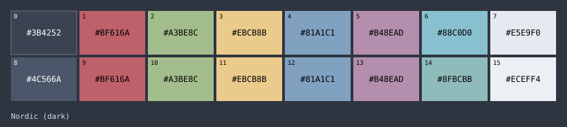

**gruvbox-material**

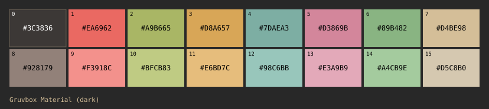 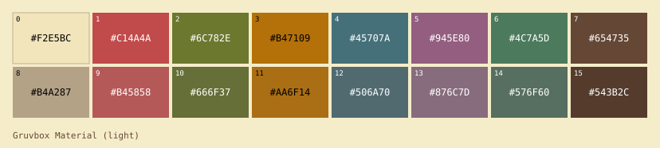

**everforest**

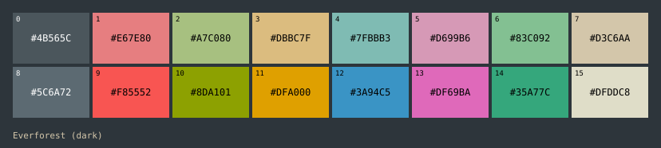 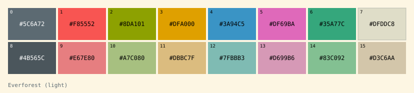

**tokyo-night**

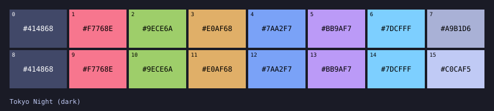 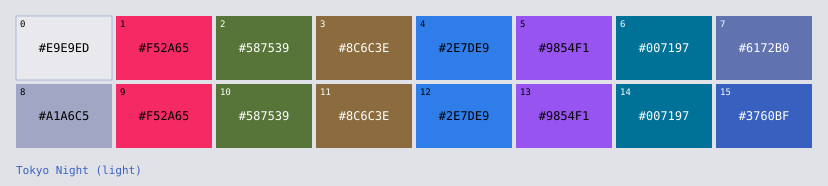

**dracula**

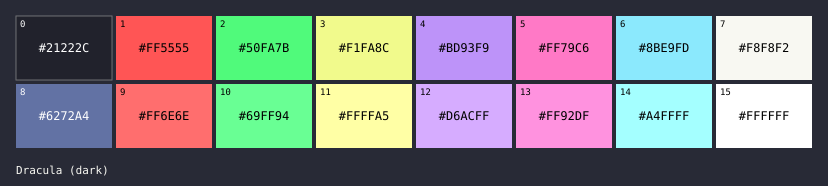 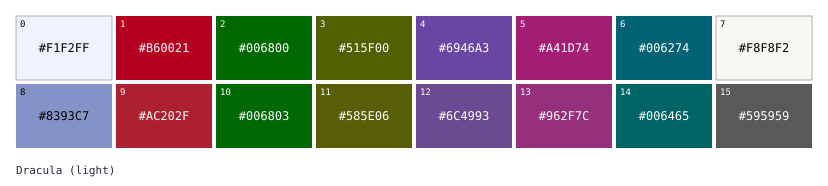

**fairy-floss**

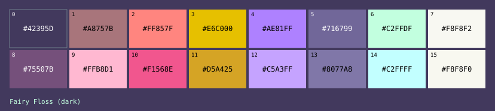

**catppuccin**

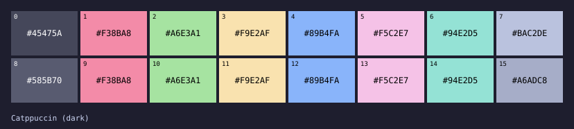 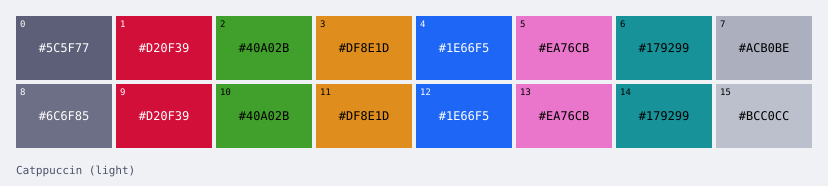

**aubergine**

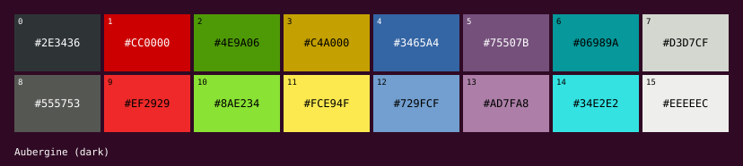

## Ghostty

If you use the Ghostty terminal and have a `~/.config/ghostty` folder, `switch-theme` also sets a matching
Ghostty theme that follows the light/dark setting of your system. Ghostty reads it through one line that you
add to your Ghostty config (`switch-theme` asks once before adding it, or prints it when there is no terminal):

```
config-file = ?candy-for-gnome.conf
```

The theme set by that line wins over a `theme =` line in your own config. Ghostty does not reload by itself:
press `ctrl+shift+,` in open Ghostty windows after switching. `remove-theme` removes the theme files and never
edits your config.

## More apps

If one of these tools is installed (found on your PATH or in the Homebrew bin folder), `install-theme` copies the
matching theme files into its config folder and `switch-theme` points the tool at the theme. Tools that are not
installed are skipped and nothing is created for them. Where the tool needs one line in its own config, `switch-theme`
asks once (default no) before changing it, and prints the exact line instead when there is no terminal. `remove-theme`
removes the theme files and never edits your configs; it tells you what you may delete.

| Tool | What it follows | The one thing your config needs | After switching |
|---|---|---|---|
| Alacritty | the light/dark setting when you run `switch-theme` | `"~/.config/alacritty/themes/candy-for-gnome.toml"` in `general.import` (after any other color import) | live reload of imports; a Noctalia apply hook can add its own `noctalia.toml` import after yours and then wins |
| Helix | the light/dark setting when you run `switch-theme` | `theme = "candy-for-gnome"` | `:config-reload` |
| Yazi | the terminal's light/dark | `dark = "candy-for-gnome-dark"` and `light = "candy-for-gnome-light"` in `[flavor]` of `theme.toml` (colors in your own `theme.toml` still win) | restart Yazi |
| kitty | the system light/dark (0.38+) | nothing | automatic |
| bat | the terminal's light/dark | `--theme="auto:system"`, `--theme-dark="candy-for-gnome-dark"`, `--theme-light="candy-for-gnome-light"` | the cache is rebuilt for you |
| eza | the light/dark setting when you run `switch-theme` | your own `theme.yml` is moved aside as `theme.yml.candy-bak` (asked once) and replaced by a link; `EZA_COLORS` or `LS_COLORS` still override it | immediate |
| zellij | the system light/dark | `theme_dark "candy-for-gnome-dark"` and `theme_light "candy-for-gnome-light"` | live reload; restart a session if needed |
| Claude Code | the light/dark setting when you run `switch-theme` | pick it once with `/theme` (stored as `custom:candy-for-gnome`); your `settings.json` is never edited | restart Claude Code once if its themes folder is new |

A dark-only theme uses its dark colors for both modes. Run `switch-theme` again after you change the system
light/dark setting for the tools marked as following it at switch time.

## Flatpak apps

Flatpak apps cannot read `~/.themes`, the icons or `~/.config/gtk-3.0|4.0` unless allowed. After
`switch-theme` you are asked once (default no) whether to grant read-only access for what is missing, and
the grant is undone when you remove the last theme and icon set. Nothing is widened silently.

## Contributing

`main` is protected. Changes go on a feature branch, into `testing` by pull request, and from `testing` into
`main` by pull request; CI is the test.
The contributor workflow and design notes are in `CLAUDE.md`. The palette pictures are generated: run `just generate <theme>` after changing a palette.

## License and credits

Tooling and docs are MIT (`LICENSE`). The generated theme files derive from GTK's and GNOME Shell's stock
stylesheets and stay LGPL: each `themes/*/gtk/<Name>/` folder carries its own `LICENSE`. Palette credits and
the exact split are in `NOTICE`. Icon sets are not part of this repository: they are downloaded from their own
projects when you install them and keep their own licenses (Conflux is GPL-3.0, by Moshiur Rahman Adib and contributors; WhiteSur is GPL-3.0, by Vince Liuice).

## Disclaimer

This is a personal project, assisted by Claude (Anthropic's coding assistant), so please excuse the slop.
I have only tested it on my own setup and will not actively maintain it beyond my own needs. If you find
something valuable here, you are encouraged to fork it.
