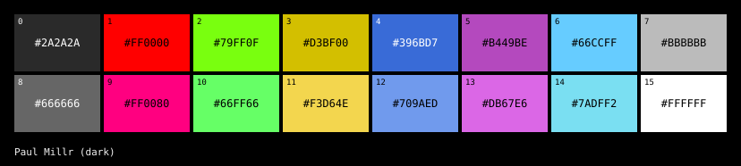

# Paul Millr

<!-- Generated by tools/theme-readme-gen.py from scheme.toml; do not edit. -->

Terminal-inspired colors for GNOME (GTK 3, GTK 4 and libadwaita, GNOME Shell) and for terminals and command-line tools. Variants: dark only.



- Colors: Paul Millr (colours of the Ptyxis built-in 'Paul Millr'; origin named in the built-in's header: https://github.com/Gogh-Co/Gogh/tree/master/themes/Paul%20Millr.yml).
- Default accent: green (#79FF0F); the other accents are listed by `switch-theme`.
- Ptyxis uses its built-in palette `Paul Millr`.

## Install and use

```
ujust gnome-candy install-theme paul-millr
ujust gnome-candy switch-theme paul-millr
```

Without the image recipe, run `just install-theme paul-millr` and `just switch-theme paul-millr` in a checkout of [candy-for-gnome](https://github.com/redcodeworks/candy-for-gnome).

## License

The generated GTK and Shell files in `gtk/` derive from the stock GTK and GNOME Shell stylesheets and stay under the LGPL (each folder there has its `LICENSE`). The tooling and this page are MIT; the color credits are in the repository `NOTICE`.
